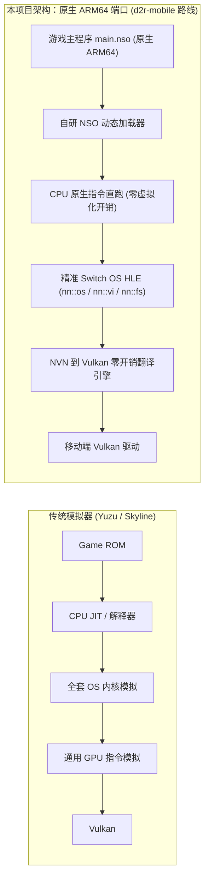
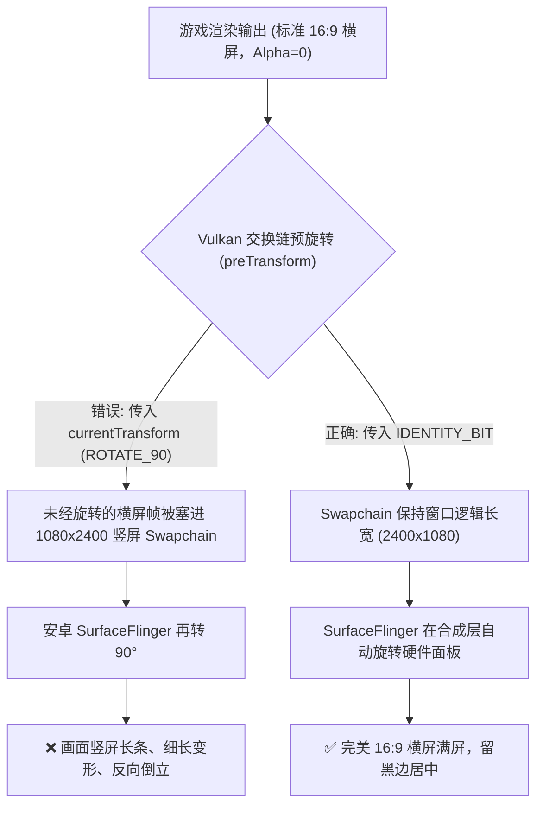
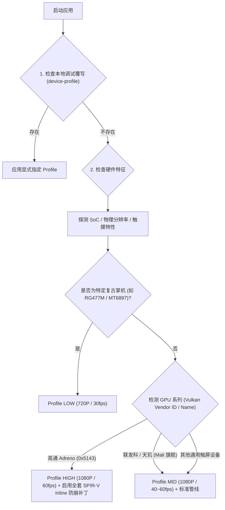

# Nintendo Switch 到 Android 原生 ARM64 游戏移植实战避坑与架构指南

> **适用场景**：将任天堂 Switch（ARM64）游戏的原生代码（NSO/ELF）通过静态重编译或动态 HLE 运行时，结合 NVN→Vulkan 兼容层原生运行于 Android 设备（Adreno / Mali GPU）的工程实践总结。

---

## 目录
1. [技术路线认知：原生移植 vs 模拟器](#一技术路线认知原生移植-vs-模拟器)
2. [内存与虚拟地址空间陷阱（16KB 页、对齐与 mmap）](#二内存与虚拟地址空间陷阱)
3. [Vulkan 图形与交换链巨坑（旋转拉伸、Alpha透明、Swapchain）](#三vulkan-图形与交换链巨坑)
4. [GPU 驱动兼容性与着色器转译（Adreno 崩溃与 SPIR-V 改写）](#四gpu-驱动兼容性与着色器转译)
5. [移动端 TBDR 架构性能陷阱（Pass 切碎与屏障风暴）](#五移动端-tbdr-架构性能陷阱)
6. [Android 窗口与生命周期（全屏、挖孔、Surface 重建）](#六android-窗口与生命周期)
7. [多机型适配与 Device Profile 架构设计](#七多机型适配与-device-profile-架构设计)
8. [大容量资源分发与文件系统权限（Scoped Storage、存档）](#八大容量资源分发与文件系统权限)
9. [音频流与蓝牙低延迟踩坑（AAudio 与采样率）](#九音频流与蓝牙低延迟踩坑)
10. [新项目冷启动避坑清单（Checklist）](#十新项目冷启动避坑清单)

---

## 一、技术路线认知：原生移植 vs 模拟器



### 核心认知
- **性能优势**：Switch 与 Android 同样基于 ARM64 指令集。游戏自身的 C++ 编译代码（Unreal Engine 5、Cuttlefish、自研引擎）在安卓 CPU 上是**100% 原生跑的**，没有 JIT 翻译开销，CPU 占用极低。
- **难点聚焦**：移植的全部难点不在 CPU 计算，而在：
  1. **操作系统服务接口（nn::*）的精准对齐**；
  2. **主机专用 NVN 图形 API 到移动端 Vulkan API 的语义转换**；
  3. **针对移动端 GPU（高通 Adreno / 联发科 ARM Mali）特异性的底层兼容**。

---

## 二、内存与虚拟地址空间陷阱

Switch 的 Horizon OS 与 Android Linux 内核在虚拟内存管理上存在微妙但致命的差异。

### 1. 16KB 页支持（Android 15+ 强制要求）
- **现象**：在较新的安卓设备（如骁龙 8 至尊版 / Android 15）上启动直接 `SIGSEGV` 或 `SIGBUS`。
- **根因**：现代 Android 15 开始支持 16KB 物理页大小，而 Switch 内核硬编码以 4KB（0x1000）作为页对齐基准。若底层 JNI 链接参数或 `mmap` 分配器写死了 `4096`，在 16KB 设备上直接断言失败或内存未对齐抛异常。
- **成熟解法**：
  - 动态获取页大小：使用 `sysconf(_SC_PAGESIZE)` 或 `getpagesize()`，分配虚拟内存守卫页时按 `max(page_size, 4096)` 对齐。
  - 编译选项：所有共享库必须加上链接参数 `-Wl,-z,max-page-size=16384`。

### 2. 虚拟地址空间保留与零地址加载（No-Relocation NSO）
- **现象**：Switch 的部分早期可执行文件（NSO）基址被硬编译在 `0x0` 或低地址，或者没有重定位表（DT_RELR）。
- **根因**：Android 平台的安全机制 `mmap_min_addr` 默认禁止用户态程序映射到 `0x0`（通常最低允许 `0x10000` 甚至 `0x100000`）。
- **成熟解法**：
  - 解析 NSO 头部中的 `MOD0` 结构体，提取动态重定位表 `DT_RELR` / `DT_RELA`；
  - 无论 NSO 头标称基址是多少，在宿主使用 `mmap(NULL, total_size, ...)` 动态向内核申请任意合法地址，然后遍历重定位项手动对内部指针进行重定向（Fixup）。

### 3. VAMM 虚拟内存管理器与对齐
- **Switch SDK 行为**：Switch SDK 的 `VammManager` 要求 2MB 以下分配必须 64KB 对齐，2MB 以上必须 2MB 对齐，且两端带 Guard Page。
- **移植避坑**：模拟 `nn::os::AllocateAddressRegion` 时，必须计算好 Guard Page，并采用 `PROT_NONE` 预占虚拟地址空间，实际需要时再用 `mprotect(..., PROT_READ|PROT_WRITE)` 提交物理内存，避免进程刚启动就将 4GB 地址空间撑爆。

---

## 三、Vulkan 图形与交换链巨坑

这是导致**横竖屏画面反转、拉伸变形、黑屏只有UI**的头号元凶。



### 1. 横竖颠倒与拉伸成竖条（`preTransform` 陷阱）
- **现象**：手机横屏打开游戏，画面被压缩成长条形纵向显示，人物被拉得又细又长，甚至方向倒置 90 度。
- **根因**：
  - 手机屏幕物理硬件面板原生是**竖屏**（0° 对应竖向，如 1080×2400）。
  - 当 Activity 设置为横屏时，Android Vulkan 底层报告的 `capabilities.currentTransform` 会变成 `VK_SURFACE_TRANSFORM_ROTATE_90_BIT_KHR` 或 `270`。
  - 如果交换链直接把 `preTransform` 设为 `currentTransform`，驱动**期望开发者在 Shader/顶点矩阵中自己把画面旋转 90 度**！
  - 如果游戏没有旋转渲染（通常都是 1:1 Blit 贴图），又未经旋转，SurfaceFlinger 硬件合成器就会把这张未旋转的竖条画面再次旋转 90 度，造成灾难性变形。
- **成熟解法**：
  ```c
  // 永远优先请求 IDENTITY 变换，将旋转工作交还给系统的硬件合成器
  if (capabilities.supportedTransforms & VK_SURFACE_TRANSFORM_IDENTITY_BIT_KHR) {
      swapchain_info.preTransform = VK_SURFACE_TRANSFORM_IDENTITY_BIT_KHR;
  } else {
      swapchain_info.preTransform = capabilities.currentTransform;
  }
  ```

### 2. 3D 场景全黑，只有 HUD/小地图可见（Alpha 丢失陷阱）
- **现象**：游戏进入后片头正常，进 3D 场景后背景全黑，只有小地图、准星和对话框文字悬浮在黑屏上。
- **根因**：
  - Switch/主机游戏的后处理管线在最终 Composite Pass 时，通常只为 2D UI 写入 Alpha 通道，3D 场景渲染出的 Alpha 值通常是 `0.0`。
  - 在 Android 上，如果 SurfaceView 使用了 `PixelFormat.RGBA_8888` 且交换链使用了 `VK_COMPOSITE_ALPHA_INHERIT_BIT_KHR`，SurfaceFlinger 会把 Alpha=0 当成**完全透明**，直接把 3D 场景全部透过，露出了 Activity 底层的纯黑背景！
- **成熟解法**：
  - Java 层：Activity 启动时设置 SurfaceView 格式为不透明格式：
    ```java
    surface_view.getHolder().setFormat(PixelFormat.RGBX_8888); // 或 PixelFormat.OPAQUE
    ```
  - Native 层：创建交换链时强制使用不透明合成通道：
    ```c
    swapchain_info.compositeAlpha = (capabilities.supportedCompositeAlpha & VK_COMPOSITE_ALPHA_OPAQUE_BIT_KHR)
        ? VK_COMPOSITE_ALPHA_OPAQUE_BIT_KHR
        : VK_COMPOSITE_ALPHA_INHERIT_BIT_KHR;
    ```

---

## 四、GPU 驱动兼容性与着色器转译

高通骁龙（Adreno）与 ARM 联发科（Mali）在 Vulkan 驱动实现上存在天壤之别。

### 1. 高通 Adreno 驱动编译器崩溃（`libllvm-qgl.so` 闪退）
- **现象**：在搭载高通骁龙 8 Gen 2 / Gen 3 / 8 至尊版（Adreno 7xx / 8xx）的手机上，刚进 3D 场景或打 Boss 放技能时，游戏瞬间闪退，`logcat` 中崩溃在 `libllvm-qgl.so`（高通专有着色器编译器）。
- **根因**：
  - Switch 的 SPIR-V 着色器大量使用了子组操作（`OpSubgroupBallotKHR`、`OpSubgroupShuffle`、`OpSubgroupQuad`）。
  - 高通官方驱动的 LLVM 后端在处理**带有辅助调用（Helper Invocations）的控制流分支**时存在已知 Bug，无法生成正确的寄存器分配，导致编译器自身 `SIGSEGV`。
- **成熟解法（引用自 d2r-mobile）**：
  - 在把 SPIR-V 传给 `vkCreateShaderModule` 之前，集成 **SPIRV-Tools** 对其进行预处理。
  - 使用 `xbg_inline_subgroup_helpers` 将包含辅助调用的内部函数**强制内联展开（Inline Rewrite）**。
  - **重要原则**：针对高通 Vendor ID `0x5143` 或名称带 `Adreno` 的 GPU **全部无差别启用**，切勿设置机型白名单。

### 2. 64-lane vs 32-lane 子组（Warp Shuffle）
- **现象**：水面倒影、草叶抖动、全屏泛光等效果在 Adreno 上产生黑斑或花屏。
- **根因**：
  - Nvidia Tegra X1（Switch）拥有 32 车道（32-lane Warp），而高通 Adreno 是 64 车道（64-lane Wavefront）。
  - Ryujinx / 编译工具转译出的 SPIR-V 代码常硬编码掩码索引为 `0..31`（如 `subgroupBallot().x`）。在 Adreno 上运行第 32~63 车道时，由于掩码高位为 0，导致洗牌取错数据。
- **成熟解法**：
  - 对 SPIR-V 进行 AST 改写：使用 `gl_SubgroupInvocationID & 31` 限制车道，或利用常量提取配合 `OpSelect` 动态选择高低 32 位字。

### 3. Stage Interface 缺失（Boss Missing Location 9）
- **现象**：特定 Boss 场景进场瞬间驱动报 `VK_ERROR_UNKNOWN`。
- **根因**：顶点着色器（VS）未输出 `Location 9`，但片元着色器（FS）声明了读取。桌面级驱动容忍这种隐式默认值，但移动端驱动会直接拒绝建管线。
- **成熟解法**：通过 SPIR-V 字节码分析，自动检测并在上一阶段注入空写入。

---

## 五、移动端 TBDR 架构性能陷阱

桌面端 GPU（如 Switch 的 Tegra 独立架构）是立即渲染模式（IMR），而手机 GPU（无论是 Mali 还是 Adreno）几乎全是**基于分块的延迟渲染（TBDR）**。

### 1. 致命的 Pass 切碎（Pass Thrashing）
- **现象**：游戏内部渲染分辨率降到 720P 甚至 540P，但在天玑或骁龙上帧率依然只有十几帧，GPU 耗时高达 60ms。
- **根因**：
  - 在 TBDR 架构下，每个 Render Pass 开启和结束都需要把 Tile 缓存刷入系统内存（Tile Store/Load）。
  - UE 引擎每帧会触发大量遮挡查询（`ReportCounter` / `SAMPLES_PASSED`）以及显式管线屏障（`PipelineBarriers`）。
  - 如果翻译层每遇到一个查询或屏障就执行一次 `vkCmdEndRenderPass`，一帧就会被切碎成几百个微小 Pass。**GPU 90% 的时间在搬运 Tile 内存，而不是画画面**。
- **成熟优化（经验法则）**：
  - **遮挡查询批处理/剔除**：在移动端，通过配置标志（如 `gfx-no-occlusion`）跳过非必要的 GPU 遮挡回读，避免强制打断 Pass。
  - **合并屏障（Barrier Merging）**：将分散的 Stage 转换屏障延迟到 Render Pass 边界统一提交。
  - **Load/Store Op 优化**：首个全面覆盖绘制启用 `LOAD_OP_DONT_CARE`，清除临时 Attachment 时用 `STORE_OP_DONT_CARE`。

---

## 六、Android 窗口与生命周期

### 1. 沉浸式全屏与防手势打断
- **要求**：游戏运行时隐藏导航栏、状态栏，且横屏时不能因为全面屏边缘手势闪退。
- **标准实现**：
  ```java
  // API 30+ 现代处理
  if (Build.VERSION.SDK_INT >= 30) {
      window.setDecorFitsSystemWindows(false);
      WindowInsetsController controller = window.getInsetsController();
      if (controller != null) {
          controller.hide(WindowInsets.Type.systemBars());
          controller.setSystemBarsBehavior(
              WindowInsetsController.BEHAVIOR_SHOW_TRANSIENT_BARS_BY_SWIPE);
      }
  }
  ```

### 2. 刘海与挖孔屏适配（Display Cutout）
- **现象**：全面屏手机侧边留出一条大黑边，画面没有撑满。
- **成熟解法**：在 Activity `onCreate` 中设置：
  ```java
  if (Build.VERSION.SDK_INT >= 28) {
      WindowManager.LayoutParams lp = getWindow().getAttributes();
      lp.layoutInDisplayCutoutMode = 
          WindowManager.LayoutParams.LAYOUT_IN_DISPLAY_CUTOUT_MODE_SHORT_EDGES;
      getWindow().setAttributes(lp);
  }
  ```

### 3. 切后台与 Surface 丢失重构
- **现象**：用户切到微信回复消息或锁屏后切回，游戏黑屏或崩溃。
- **根因**：安卓在应用退后台时会立即销毁 `Surface`，`ANativeWindow` 指针失效。如果渲染线程继续调用 `vkQueuePresentKHR`，会收到 `VK_ERROR_SURFACE_LOST_KHR`。
- **成熟解法**：
  - `surfaceDestroyed` 时安全释放当前 Vulkan Swapchain，并置空平台窗口句柄。
  - 渲染主循环在检测到窗口为空时，进入 `usleep(16000)` 休眠等待，丢弃中间呈现。
  - `surfaceCreated` 再次触发时，重新建 Surface 并安全重建 Swapchain。

---

## 七、多机型适配与 Device Profile 架构设计

严禁针对具体设备型号硬编码白名单！以下是成熟的档位分级模型：



### 档位标准表（SSOT）

| 档位 Profile | 典型芯片 / 设备 | 渲染分辨率 | 目标帧率 | 特性配置 |
|---|---|---|---|---|
| **`handheld_mid` (Low)** | MT6897 / Mali-G615（RG477M 掌机） | 720P | 30 FPS | 极简着色器、关闭内联改写、保守内存池 |
| **`phone_mid` (Mid)** | 骁龙 8s Gen 3 / 8 Gen 2 / 天玑 9200 | 1080P | 30~45 FPS | 启用通用 IDENTITY 变换、Adreno 防崩 |
| **`phone_high` (High)** | 骁龙 8 Gen 3 / 8 至尊版（Adreno 830） | 1080P | 60 FPS | 全特性开启、SPIR-V Inline、完全不透明合成 |

---

## 八、大容量资源分发与文件系统权限

### 1. 存储架构：Universal APK + External Game Data
- **严禁将 10GB~20GB 的游戏数据打包进 APK**（安装极慢且会被系统杀掉）。
- **标准布局**：
  ```
  /sdcard/
    └── <GAME_NAME>/          # 用户只需解压到内部存储根目录
          ├── main.nso        # 游戏主执行体
          ├── sdk.nso         # Switch SDK 共享库
          ├── romfs/          # 游戏解包或挂载 ROMFS
          └── shaders.hnla    # 预编译着色器紧凑归档
  ```

### 2. Scoped Storage 与全文件访问权限
- **现象**：安装后提示找不到数据，但文件明明放在了根目录。
- **根因**：Android 11+（API 30+）强制开启分区存储（Scoped Storage），普通文件读取 API 无法读取非自身应用目录。
- **成熟解法**：
  - 在 `AndroidManifest.xml` 中声明：
    ```xml
    <uses-permission android:name="android.permission.MANAGE_EXTERNAL_STORAGE" />
    ```
  - Java 启动时检测并引导用户跳转授权：
    ```java
    if (Build.VERSION.SDK_INT >= 30 && !Environment.isExternalStorageManager()) {
        Intent intent = new Intent(Settings.ACTION_MANAGE_APP_ALL_FILES_ACCESS_PERMISSION);
        intent.setData(Uri.parse("package:" + getPackageName()));
        startActivity(intent);
    }
    ```

### 3. 日志覆盖与崩溃排查（`O_TRUNC` 陷阱）
- **现象**：用户反馈启动闪退，但发过来的 `guest_boot.log` 里空空如也，或者只有新一次启动的几行。
- **根因**：启动时使用 `open(path, O_WRONLY|O_CREAT|O_TRUNC)` 重定向 `stdout/stderr`，崩溃后用户重新点开应用，立刻抹除了上次崩溃的关键调用栈！
- **成熟解法**：启动时如果发现已有日志文件，先重命名备份为 `guest_boot_prev.log`，再开辟新日志。

---

## 九、音频流与蓝牙低延迟踩坑

### 1. AAudio 模式陷阱
- **现象**：游戏音效断断续续，或者连上蓝牙耳机后声音卡死。
- **成熟配置**：
  - **不要盲目开启 `AAUDIO_PERFORMANCE_MODE_LOW_LATENCY`**：低延迟模式在部分安卓机型和蓝牙设备上会分配极小的音频缓冲，一旦主线程稍有掉帧立刻发生 Buffer Underrun（爆音、杂音）。
  - **优先使用 `AAUDIO_PERFORMANCE_MODE_NONE`**，并由应用自建两级环形缓冲区（Ring Buffer）。

### 2. 热插拔监听（`AudioDeviceCallback`）
- 必须注册 `AudioManager.registerAudioDeviceCallback`：当用户插拔有线耳机或连接断开蓝牙耳机时，底层音频采样率或通道可能改变，必须主动通知音频运行时安全重置流。

---

## 十、新项目冷启动避坑清单

在开始下一个游戏移植时，逐项核对本清单可规避 90% 的低级错误：

```markdown
### 基础底座
- [ ] 编译链包含 `-Wl,-z,max-page-size=16384`（支持 16KB 页机型）。
- [ ] NSO Loader 支持任意基址动态重定位，不假设 0 地址可用。
- [ ] 申请虚拟内存预留 Guard Page，按动态 host page size 对齐。

### 画面与窗口
- [ ] AndroidManifest 设置 `android:screenOrientation="sensorLandscape"`。
- [ ] SurfaceView 格式显式设置为 `PixelFormat.RGBX_8888`（防止 Alpha=0 变黑屏）。
- [ ] Vulkan 交换链 `preTransform` 优先使用 `VK_SURFACE_TRANSFORM_IDENTITY_BIT_KHR`。
- [ ] Swapchain 合成通道优先选择 `VK_COMPOSITE_ALPHA_OPAQUE_BIT_KHR`。
- [ ] 实现针对屏幕缺口（Cutout）的短边浸入式全屏。

### 驱动与着色器
- [ ] 集成 SPIRV-Tools，针对所有高通 Adreno（Vendor 0x5143）开启 Subgroup Inlining。
- [ ] 实现针对 64-lane 子组（Adreno）的掩码扩展与 Workgroup 同步。
- [ ] 着色器加载阶段实现本地缓存（Shader Cache），避免进入战斗时首次编译严重卡顿。

### 资源分发与运维
- [ ] 采用“单一通用 APK + 外部数据包”模式，数据包换机不重换。
- [ ] 申请并妥善处理 `MANAGE_EXTERNAL_STORAGE` 权限。
- [ ] 崩溃日志在每次冷启动时滚动备份为 `prev.log`，防止被 `O_TRUNC` 抹除。
- [ ] 设备档位 Profile 仅区分必要能力（Low/Mid/High），不针对具体商用型号写死名单。
```
